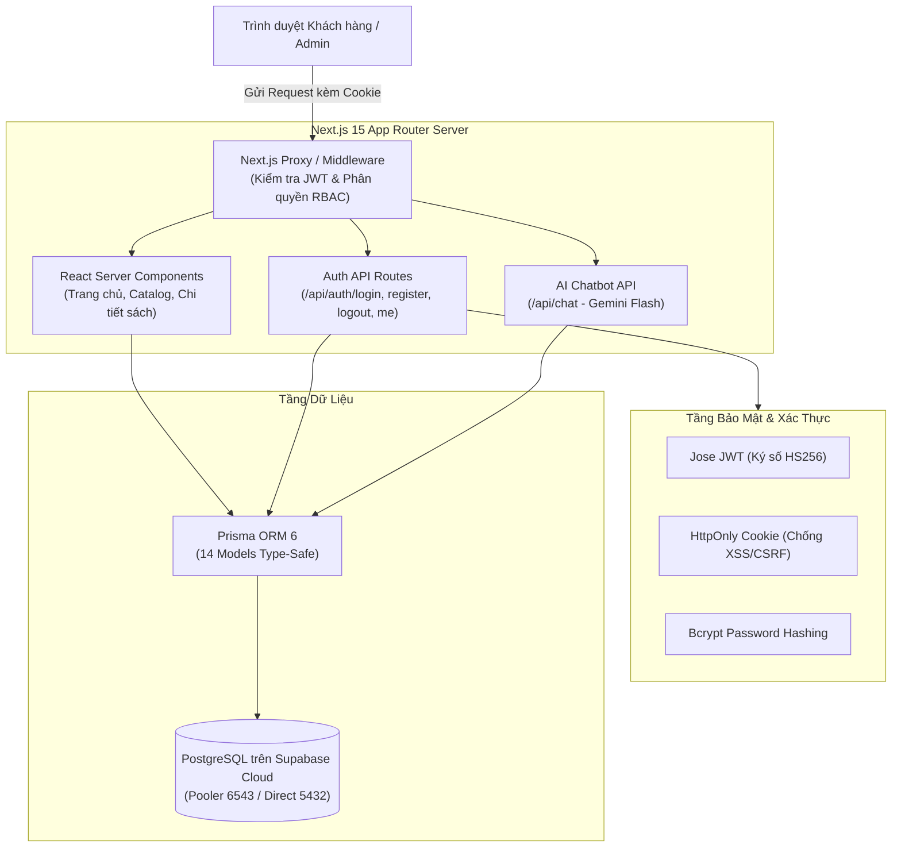
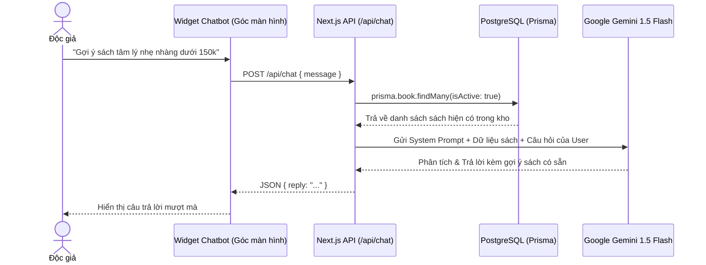
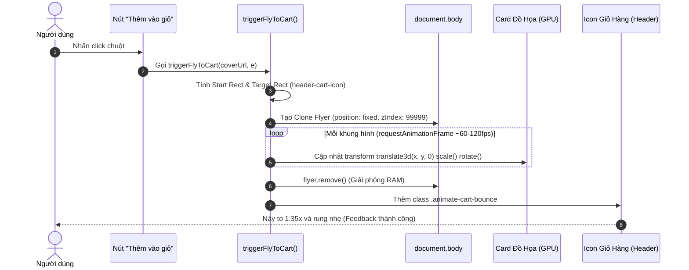
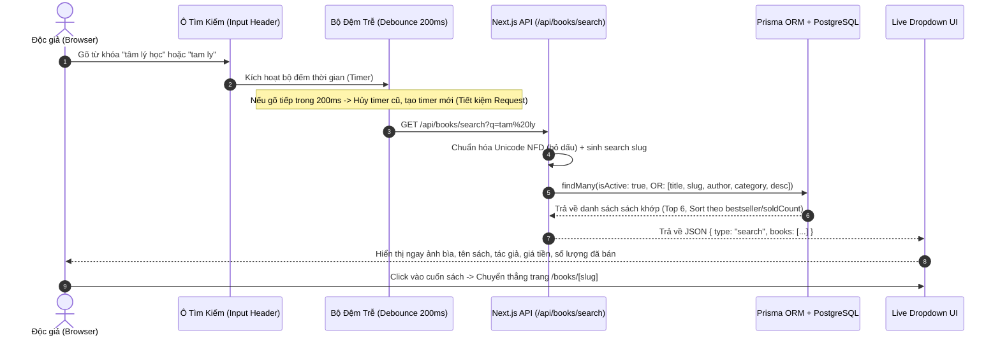
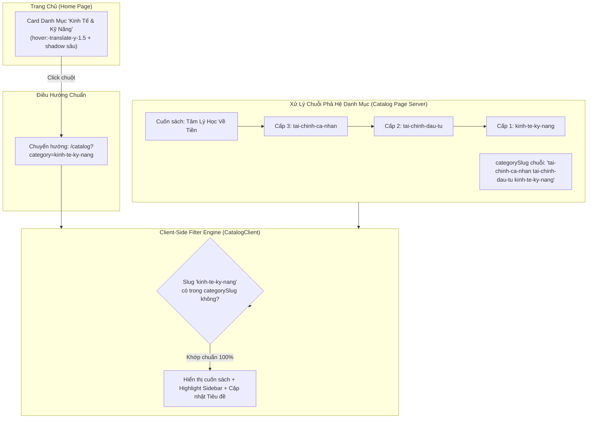
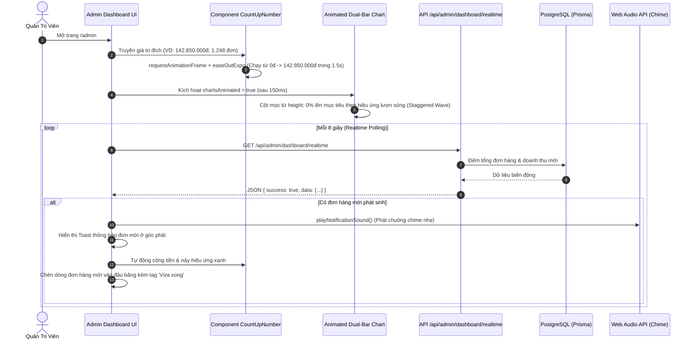
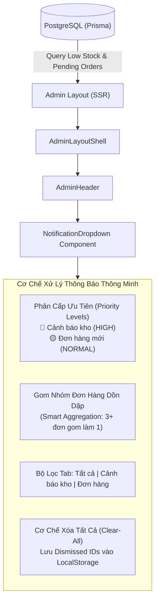
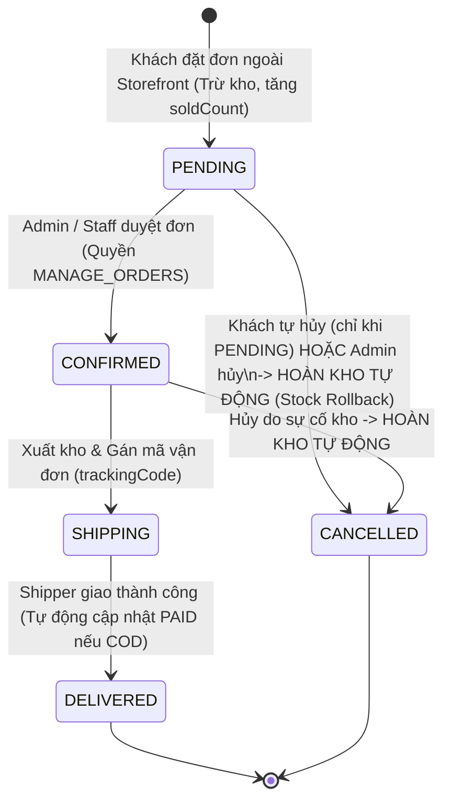
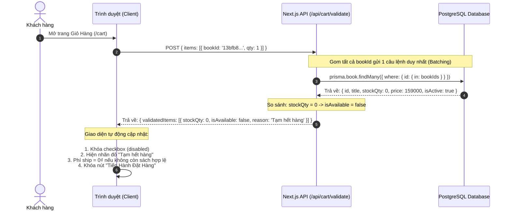
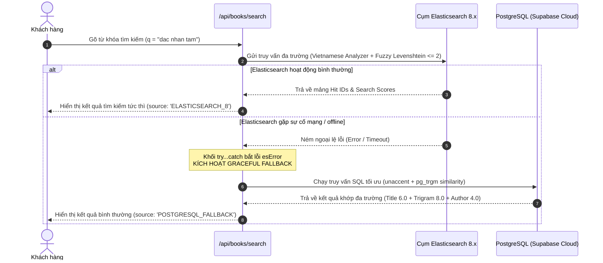

# 📚 CẨM NANG ÔN TẬP & BẢO VỆ ĐỒ ÁN — TỔ SÁCH
> **Đề tài:** Hệ thống Thương mại Điện tử Bán Sách Trực tuyến (B2C)  
> **Chuyên ngành:** Công nghệ Thông tin (Đồ án liên ngành)  
> **Nhóm tác giả thực hiện:**  
> * **Nguyễn Đăng Hanh** (hnhngyndng@gmail.com)  
> * **Nguyễn Mạnh Hòa**  
> **Tài liệu nội bộ:** ĐÃ BỎ QUA TRÊN GIT (KHÔNG PUSH)

---

## 🗺️ Bản Đồ Kiến Trúc Hệ Thống (Architecture Map)



---

## 📌 PHẦN 1: TỔNG HỢP 10 CÂU HỎI VÀ GIẢI ĐÁP KỸ THUẬT CỐT LÕI

### 1. Tài khoản Git & Remote Repository
> [!NOTE]
> * **Tài khoản Git cục bộ:** `Hanh-Dang` (`hnhngyndng@gmail.com`).
> * **Remote GitHub:** `https://github.com/Hanh-Dang/DALN-CNTT-1-1-26-N02_To-Sach.git`.
> * **Nhánh chính:** `main`.

---

### 2. Danh mục phân loại file: Push Git vs Giấu an toàn
| Phân loại | Danh sách file / thư mục | Lý do kỹ thuật |
|---|---|---|
| ❌ **TUYỆT ĐỐI KHÔNG PUSH** *(Đã đưa vào `.gitignore`)* | `.env`, `legacy/`, `UI/`, `.claude/`, `.cursor/`, `.devin/`, `.agents/`, `node_modules/`, `.next/`, `QNA_STUDY_GUIDE.md` | Bảo mật mật khẩu DB/khóa JWT bí mật; tránh phình to repo bằng file HTML/ảnh thiết kế và file tạm. |
| ✅ **ĐẨY LÊN GITHUB** | `src/`, `prisma/`, `PROJECT_DOCUMENTATION.md`, `README.md`, `.env.example`, `package.json`, `tsconfig.json` | Toàn bộ mã nguồn cốt lõi, schema database, tài liệu hướng dẫn và cấu hình dự án. |

---

### 3. Cơ chế của lệnh `git add .` kết hợp `.gitignore`
> [!TIP]
> * **Nguyên lý:** `.gitignore` hoạt động như một bức tường lửa ở cấp độ Git. Khi một file/thư mục đã khai báo trong `.gitignore`, lệnh `git add .` sẽ **chủ động bỏ qua tuyệt đối**.
> * **Cách kiểm tra nhanh:** Chạy `git status -s`. Những file nào không xuất hiện trong danh sách này thì 100% sẽ không bao giờ bị đưa lên Git.

---

### 4. Nguồn gốc & Ý nghĩa của `AGENTS.md` và `CLAUDE.md`
* **`AGENTS.md`:** File cấu hình tự động do chính **Next.js 15 sinh ra**. Chứa các chỉ dẫn quy chuẩn của phiên bản Next.js mới nhất (như Proxy thay cho Middleware, Server Actions) cho các AI lập trình (Antigravity, Cursor, Devin, Claude).
* **`CLAUDE.md`:** Cú pháp tham chiếu `@AGENTS.md` của công cụ Claude Code.
* Cả 2 file đều < 1KB, hoàn toàn vô hại và giúp AI viết code chuẩn chỉ.

---

### 5. NextAuth.js vs Custom JWT — Lựa chọn nào tối ưu cho bảo vệ đồ án?
| Tiêu chí so sánh | NextAuth.js (Auth.js) | Custom JWT + HttpOnly Cookie *(Đồ án chọn)* |
|---|---|---|
| **Cơ chế hoạt động** | Thư viện đóng gói sẵn API và mã hóa session | Tự viết hàm băm mật khẩu `bcryptjs` và ký số JWT bằng `jose` |
| **Nơi lưu Token** | Session cookie mã hóa tự động | `HttpOnly Cookie` (JavaScript bên ngoài không thể đọc, chống XSS) |
| **Khi bảo vệ trước Hội đồng** | Khó trả lời sâu nếu thầy cô hội đồng hỏi cấu trúc mã hóa bên trong | **Tự tin ghi điểm tối đa**: Bạn vẽ được sơ đồ luồng dữ liệu, chứng minh năng lực tự xây dựng xác thực bảo mật chuẩn RFC 7519 |

---

### 6. Vì sao dùng Supabase PostgreSQL Cloud thay vì cài Docker Local?
* **Tối ưu RAM:** Không làm đơ/chậm máy vì phải chạy Docker Desktop (tiết kiệm 4 - 6 GB RAM).
* **Đúng Proposal:** Đề cương đồ án đã đăng ký chính thức dùng dịch vụ Supabase.
* **Quản trị trực quan:** Supabase có sẵn giao diện Web Table Editor, SQL Editor để tra cứu dữ liệu cực nhanh.
* **Connection Pooling:** Tích hợp sẵn PgBouncer (cổng 6543) giải quyết bài toán nghẽn kết nối cho ứng dụng serverless.

---

### 7. Cảnh báo "RLS Disabled in Public" trên Supabase có đáng lo ngại không?
> [!IMPORTANT]
> * **Bản chất:** Supabase cảnh báo cho ứng dụng Frontend gọi trực tiếp DB bằng Client-side JS qua `Anon Key`.
> * **Thực tế hệ thống của bạn:** Khách hàng **không gọi trực tiếp** vào Supabase mà bắt buộc phải đi qua Next.js Server (nơi code `middleware.ts` kiểm tra JWT). Next.js kết nối PostgreSQL bằng quyền quản trị tối cao (`DATABASE_URL`). Vì vậy hệ thống **hoàn toàn an toàn**.
> * **Cách bật để Supabase xanh 100%:** Chạy lệnh SQL:
>   ```sql
>   ALTER TABLE public.books ENABLE ROW LEVEL SECURITY;
>   ALTER TABLE public.users ENABLE ROW LEVEL SECURITY;
>   -- (Chạy tương tự cho các bảng còn lại)
>   ```

---

### 8. Cảnh báo đỏ Hydration Mismatch (`trancy-version`) là gì?
* **Nguyên nhân:** Do tiện ích dịch ngoại ngữ **Trancy** trên Chrome/Edge tự ý chèn thuộc tính `trancy-version="7.9.3"` vào thẻ `<html>` trên trình duyệt.
* **Cách xử lý chuẩn Next.js:** Thêm `suppressHydrationWarning` vào thẻ `<html lang="vi" suppressHydrationWarning>` trong [`src/app/layout.tsx`](file:///e:/to-sach-studio/src/app/layout.tsx).

---

### 9. Bản chất B2C thuần túy & Danh sách thành phần đã LOẠI BỎ
> [!WARNING]
> **Tổ Sách là Nhà Sách Trực Tuyến B2C — KHÔNG PHẢI Sàn C2C/Marketplace.**
> 
> Các thành phần sau đã bị xóa bỏ hoàn toàn khỏi phạm vi đồ án:
> 1. ❌ **Banner kêu gọi Seller / Trở thành người bán cá nhân.**
> 2. ❌ **Realtime Feed người dùng đăng bán sách cũ.**
> 3. ❌ **Request Rare Book Banner (Cộng đồng tìm sách hiếm).**
> 4. ❌ **Ô nhập mã Voucher ở giỏ hàng và Quản lý Voucher ở Admin.**

---

### 10. Phân định: Production UI vs Dev/Testing-Only UI
* **Production UI (Chính thức):** Trang chủ, Catalog 3 cấp, Chi tiết sách, Đánh giá, Giỏ hàng, Thanh toán COD/QR ngân hàng, Đơn mua, Admin Dashboard, Kho sách, Phân quyền RBAC. Toàn bộ kết nối dữ liệu thật từ PostgreSQL.
* **Dev/Testing-Only UI (Nội bộ):** Nút **Dev Role Quick Switcher** (chuyển đổi nhanh giữa Khách hàng $\leftrightarrow$ Staff Kho $\leftrightarrow$ Staff Đơn $\leftrightarrow$ Admin). Bắt buộc bọc trong `if (process.env.NODE_ENV !== 'production')` để tự động ẩn khi nghiệm thu đồ án.

---

## 🤖 PHẦN 2: CHUYÊN ĐỀ ĐẶC BIỆT — FLOATING AI CHATBOT (GEMINI FLASH)

### 1. Định nghĩa & Lợi ích
* **Là gì?** Nút tròn nổi lơ lửng ở góc dưới bên phải màn hình. Bấm vào sẽ mở ra khung chat trò chuyện tự nhiên với Trợ lý AI của Tổ Sách.
* **Ưu điểm tài khoản Gemini Pro của bạn:** Bạn có thể sử dụng mô hình **Gemini 1.5 Flash / 2.0 Flash**:
  - Tốc độ phản hồi cực nhanh: **< 1 giây**.
  - Cửa sổ ngữ cảnh khổng lồ: **1.000.000 tokens** (thoải mái nạp toàn bộ danh mục sách vào bối cảnh).
  - Khả năng hiểu tiếng Việt và văn hóa đọc sách Việt Nam xuất sắc.

---

### 2. Kiến Trúc Hoạt Động (RAG - Retrieval-Augmented Generation)



---

### 3. Hướng Dẫn Tích Hợp 4 Bước Nhanh Gọn (Khi Sẵn Sàng Làm Bonus Feature)

#### Bước 1: Lấy API Key và thêm vào `.env`
Vào [Google AI Studio](https://aistudio.google.com/) $\rightarrow$ Lấy API Key rồi điền vào [`.env`](file:///e:/to-sach-studio/.env):
```env
GEMINI_API_KEY="AIzaSyYourSecretGeminiKey..."
```

#### Bước 2: Cài đặt thư viện chính thức
```bash
npm install @google/genai
```

#### Bước 3: Tạo API Route xử lý Chat (`src/app/api/chat/route.ts`)
```typescript
import { NextRequest, NextResponse } from 'next/server';
import { GoogleGenAI } from '@google/genai';
import { prisma } from '@/lib/prisma';

const ai = new GoogleGenAI({ apiKey: process.env.GEMINI_API_KEY });

export async function POST(req: NextRequest) {
  try {
    const { message } = await req.json();

    // 1. Trích xuất sách thực tế từ kho Supabase
    const availableBooks = await prisma.book.findMany({
      where: { isActive: true },
      select: { title: true, price: true, slug: true, description: true },
      take: 20,
    });

    const systemInstruction = `
      Bạn là Trợ lý AI thông minh của Nhà Sách Tổ Sách ("Sách về tổ, tri thức bay xa").
      Nhiệm vụ của bạn là tư vấn chọn sách, giải đáp thắc mắc và gợi ý sách phù hợp cho khách hàng.
      Đây là danh mục các cuốn sách hiện có trong kho:
      ${JSON.stringify(availableBooks)}
      Quy tắc: Luôn trả lời bằng tiếng Việt thân thiện, súc tích và khéo léo đính kèm tên sách có trong kho.
    `;

    // 2. Gọi mô hình Gemini Flash
    const response = await ai.models.generateContent({
      model: 'gemini-1.5-flash',
      contents: message,
      config: {
        systemInstruction,
        temperature: 0.7,
      },
    });

    return NextResponse.json({ reply: response.text });
  } catch (error) {
    console.error('Chatbot API error:', error);
    return NextResponse.json({ error: 'Không thể kết nối với Trợ lý AI' }, { status: 500 });
  }
}
```

#### Bước 4: Tái sử dụng giao diện Chatbot từ `legacy/`
* Copy file [`legacy/src/components/ChatbotWidget.tsx`](file:///e:/to-sach-studio/legacy/src/components/ChatbotWidget.tsx) vào thư mục `src/components/ChatbotWidget.tsx`.
* Thay đổi hàm gọi fetch trong widget trỏ tới `/api/chat`.
* Đặt `<ChatbotWidget />` vào file [`src/app/layout.tsx`](file:///e:/to-sach-studio/src/app/layout.tsx).
* $\rightarrow$ Ngay lập tức toàn bộ website sẽ có biểu tượng nút tròn nổi trò chuyện bằng trí tuệ nhân tạo cực kỳ ấn tượng!

---

## 🎨 PHẦN 3: KỸ THUẬT HIỆU ỨNG TƯƠNG TÁC CAO CẤP — PARABOLIC FLY-TO-CART (NÉM SÁCH VÀO GIỎ HÀNG)

> **File mã nguồn:** [`src/lib/flyToCart.ts`](file:///e:/to-sach-studio/src/lib/flyToCart.ts)  
> **Keyframes CSS:** [`src/app/globals.css`](file:///e:/to-sach-studio/src/app/globals.css) (class `.animate-cart-bounce`)  
> **Điểm kích hoạt:** [`src/context/CartContext.tsx`](file:///e:/to-sach-studio/src/context/CartContext.tsx) (hàm `addToCart`)



---

### 1. Tại sao tính năng này giúp ghi điểm lớn trước Giảng viên / Hội đồng?

1. **Trải nghiệm tâm lý học thị giác (Spatial Awareness & Mental Model):**
   - Đa số website bình thường khi thêm giỏ hàng chỉ tăng con số nhỏ ở góc màn hình. Người dùng mắt đang tập trung vào nút bấm dưới đáy trang sẽ **không nhận ra giỏ hàng đã tăng**, dẫn đến việc bấm liên tục nhiều lần.
   - Hiệu ứng ném cuốn sách dẫn dắt ánh nhìn (Eye tracking) của người dùng từ vị trí cuốn sách bay thẳng lên góc phải trên cùng. Khách hàng lập tức biết giỏ hàng nằm ở đâu và xác nhận 100% món hàng đã được cất an toàn.
2. **Micro-interaction hai chiều (Dual-interaction Loop):**
   - Không chỉ sách bay, mà khi sách chạm đích, chiếc giỏ hàng sẽ nảy rung (Elastic Bounce). Giống như chiếc lưới bóng rổ rung lên khi quả bóng rơi vào rổ, tạo cảm giác vô cùng thỏa mãn (Delight factor).
3. **Thuần JavaScript / TypeScript (Zero Dependency):**
   - Không cần cài thư viện nặng nề như Framer Motion, GSAP hay jQuery. Code chỉ ~100 dòng, kích thước < 3KB, chạy độc lập và có thể mang đi tái sử dụng cho bất kỳ dự án nào.

---

### 2. Nguyên lý Toán Học: Quỹ Đạo Vòng Cung Parabol

Nếu sách bay theo một đường chéo thẳng tuột, mắt người nhìn sẽ cảm thấy rất "cơ học" và giả tạo. Vật thể trong tự nhiên khi bị ném đi luôn chịu tác động của lực ném và trọng lực, tạo thành một **đường cong Parabol bổng lên trời rồi rơi xuống**.

Hệ thống tính toán vị trí tại mỗi thời điểm $t$ ($0 \le t \le 1$ tương ứng từ $0\text{ms} \to 750\text{ms}$):

#### A. Trục hoành $X(t)$ — Easing mượt mà
Chuyển vị theo hàm bậc hai `easeInOutQuad`:
$$\text{ease}(t) = \begin{cases} 2t^2 & \text{nếu } t < 0.5 \\ -1 + (4 - 2t)t & \text{nếu } t \ge 0.5 \end{cases}$$
$$X(t) = X_{\text{start}} + (X_{\text{end}} - X_{\text{start}}) \cdot \text{ease}(t)$$

#### B. Trục tung $Y(t)$ — Cung Parabol ngược
Trục $Y$ trên màn hình máy tính có hướng từ trên xuống dưới ($Y = 0$ ở mép trên cùng). Để ném vồng lên không trung, tọa độ $Y$ phải giảm đi:
$$Y_{\text{linear}}(t) = Y_{\text{start}} + (Y_{\text{end}} - Y_{\text{start}}) \cdot \text{ease}(t)$$
$$\Delta Y_{\text{parabola}}(t) = 4 \cdot H \cdot t \cdot (1 - t)$$
$$Y(t) = Y_{\text{linear}}(t) - \Delta Y_{\text{parabola}}(t)$$

> [!NOTE]
> * Biểu thức $4 \cdot t \cdot (1 - t)$ đạt giá trị cực đại bằng $1$ chính xác tại thời điểm giữa chừng $t = 0.5$.
> * $H$ là độ cao đỉnh vòm (Arc Height), được tính toán động dựa vào khoảng cách màn hình:  
>   $H = \text{clamp}(140\text{px}, 320\text{px}, \text{horizontalDist} \times 0.25 + \text{verticalDist} \times 0.35 + 80)$.  
>   Nhờ vậy, dù bấm ở góc màn hình nào thì đường parabol trông vẫn tự nhiên và cân đối.

#### C. Biến đổi kích thước (Scale), Xoay (Rotate) và Mờ dần (Fade-out)
* **Scale:** Thu nhỏ từ kích thước ban đầu ($1.0$) về nhỏ li ti ($0.22$) khi chui vào giỏ:
  $$\text{Scale}(t) = 1 - 0.78 \cdot t$$
* **Rotate:** Xoay tròn 1 vòng $360^\circ$ quanh tâm trong suốt chuyến bay:
  $$\text{Rotate}(t) = t \cdot 360^\circ$$
* **Opacity:** Giữ nguyên độ rõ $100\%$, chỉ mờ dần khi sắp rơi tọt vào giỏ ($t > 0.85$):
  $$\text{Opacity}(t) = \frac{1 - t}{0.15}$$

---

### 3. Bí Quyết Hiệu Năng: Tại sao đạt 60fps - 120fps không giật lag?

| Tiêu chí | Cách làm sai (Nghiệp dư) | Cách làm tối ưu của Tổ Sách (Chuẩn Kỹ Sư) |
|---|---|---|
| **Thuộc tính CSS** | Dùng `top: ...px`, `left: ...px` | Dùng **`transform: translate3d(x, y, 0)`** |
| **Vòng đời Render** | Kích hoạt cả 3 giai đoạn: **Layout (Reflow) $\rightarrow$ Paint (Repaint) $\rightarrow$ Composite** | Chỉ kích hoạt duy nhất giai đoạn: **Composite (GPU)** |
| **Bộ xử lý** | Ép CPU tính toán vị trí của toàn bộ các phần tử xung quanh trên trang web | Đẩy phần tử lên một Layer riêng trên **Card màn hình (GPU)** |
| **Timer** | Dùng `setInterval(fn, 16)` (dễ bị lệch khung hình, lag khi đổi tab) | Dùng **`requestAnimationFrame(fn)`** (đồng bộ chuẩn xác tần số quét màn hình 60Hz/120Hz/144Hz) |
| **Khử rác RAM** | Quên xóa DOM dẫn tới rò rỉ bộ nhớ (Memory Leak) | Tự động gọi `flyer.remove()` ngay khi $t = 1$ |

> [!TIP]
> **Câu thần chú giải thích cho Giảng viên:**  
> *"Thưa Thầy/Cô, việc thay đổi `top`/`left` buộc trình duyệt phải tính toán lại kích thước và vị trí của toàn bộ cây DOM (Reflow), làm tụt FPS nghiêm trọng đặc biệt trên điện thoại cấu hình yếu. Bằng cách sử dụng `translate3d`, hệ thống ép trình duyệt đưa vật thể vào một GPU Composite Layer độc lập, GPU chỉ việc tính toán phép tịnh tiến ma trận phần cứng nên chuyển động đạt chuẩn 60fps mượt mà tuyệt đối."*

---

### 4. Hướng Dẫn Từng Bước Cách Tự Triển Khai (Code Thuần Tái Sử Dụng)

Nếu bạn muốn áp dụng hiệu ứng này vào một dự án mới bất kỳ, chỉ cần thực hiện 4 bước sau:

#### Bước 1: Khai báo Animation giỏ hàng rung nảy trong CSS (`globals.css`)
```css
@keyframes cartBounce {
  0% { transform: scale(1); }
  25% { transform: scale(1.35) rotate(-12deg); }
  50% { transform: scale(1.2) rotate(10deg); }
  75% { transform: scale(1.1) rotate(-4deg); }
  100% { transform: scale(1) rotate(0deg); }
}

.animate-cart-bounce {
  animation: cartBounce 0.6s cubic-bezier(0.34, 1.56, 0.64, 1);
}
```

#### Bước 2: Đánh dấu ID cho biểu tượng Giỏ Hàng trên Header
```tsx
<Link href="/cart" id="header-cart-icon" className="relative p-2.5 ...">
  <ShoppingBag className="w-5 h-5" />
</Link>
```

#### Bước 3: Tạo hàm tiện ích `flyToCart.ts`
Xem chi tiết toàn bộ code mẫu tại file [`src/lib/flyToCart.ts`](file:///e:/to-sach-studio/src/lib/flyToCart.ts).

#### Bước 4: Gọi hàm khi bấm nút "Thêm vào giỏ"
Truyền sự kiện click chuột `e` vào hàm:
```tsx
<button
  onClick={(e) => {
    addToCart(book, 1, e); // Truyền sự kiện e để lấy tọa độ bắt đầu
  }}
>
  Thêm vào giỏ
</button>
```

---

> [!TIP]
> **Câu hỏi phản biện & kịch bản thuyết trình bảo vệ cho hiệu ứng này:**  
> Đã được tổng hợp đầy đủ tại [**`CAU_HOI_THUYET_TRINH_BAO_VE_DO_AN.md`**](file:///e:/to-sach-studio/CAU_HOI_THUYET_TRINH_BAO_VE_DO_AN.md) (Mục 2.B & Câu hỏi 10).

---

## 🔍 PHẦN 4: CHUYÊN ĐỀ ÔN TẬP THỰC CHIẾN (PHẦN 2) — KỸ THUẬT XÂY DỰNG THANH TÌM KIẾM THÔNG MINH, LIVE AUTOCOMPLETE & TÌM KIẾM ĐA TIÊU CHÍ KHÔNG DẤU

> **File mã nguồn Frontend:** [`src/components/layout/CustomerHeader.tsx`](file:///e:/to-sach-studio/src/components/layout/CustomerHeader.tsx)  
> **File mã nguồn API Backend:** [`src/app/api/books/search/route.ts`](file:///e:/to-sach-studio/src/app/api/books/search/route.ts)  
> **Mô hình ORM:** Prisma 6 kết nối PostgreSQL (Supabase Cloud)



---

### 1. Phân Tích Bài Toán UX & Tối Ưu Giao Diện Thanh Tìm Kiếm

| Chi tiết giao diện | Trước khi tối ưu (Lỗi thời) | Sau khi tối ưu (Chuẩn E-commerce hiện đại) | Giá trị trải nghiệm (UX Value) |
|---|---|---|---|
| **Vị trí Icon Kính lúp** | Nằm bên trái ô nhập liệu | **Chuyển sang bên phải**, tích hợp vào nút bấm tròn màu Navy `#0B1F3A` | Theo quy luật thị giác F-Pattern, lề trái để nhập text thoáng đãng; icon bên phải đóng vai trò là "Nút hành động" (Call-To-Action) kích hoạt tìm kiếm. |
| **Dấu Mũi tên (`ArrowRight`)** | Có một mũi tên bên phải gây trùng lặp với icon kính lúp | **Đã loại bỏ hoàn toàn**, thay thế duy nhất bằng icon Kính lúp (`Search`) | Loại bỏ sự mơ hồ cho người dùng (trước đây có 2 biểu tượng hành động: kính lúp bên trái và mũi tên bên phải). |
| **Nút Xóa Nhanh (`X`)** | Không có, muốn xóa phải bôi đen hoặc ấn phím Backspace | Tự động xuất hiện nút `X` mờ khi ô có chữ, ấn vào xóa trắng ngay | Giúp người dùng xóa nhanh từ khóa chỉ bằng 1 cú click, đặc biệt hữu ích trên thiết bị di động. |
| **Gợi ý khi chưa gõ (Empty State)** | Ô trống trơn không có thông tin | Hiển thị **Sách được quan tâm nhiều nhất** + các tag từ khóa hot (`Tâm lý học`, `Nhà Giả Kim`, `Sapiens`...) | Kích thích hành vi khám phá (Discovery), dẫn dắt người dùng chưa biết mua gì vào các đầu sách bán chạy nhất. |

---

### 2. Kỹ Thuật Frontend: Debouncing & Quản Lý Vòng Đời Tìm Kiếm

#### A. Kỹ thuật Debounce (Chống Spam Request)
Khi người dùng gõ từ `"tâm lý học"`, họ bấm phím liên tục khoảng 10 lần trong 1 - 2 giây. Nếu mỗi phím bấm đều gửi request thì server sẽ nhận 10 request dồn dập, gây lãng phí băng thông và nghẽn CPU database.

**Giải pháp trong `useEffect`:**
```tsx
useEffect(() => {
  // 1. Nếu từ khóa rỗng -> Gọi gợi ý sách phổ biến ngay lập tức
  if (!searchQuery.trim()) {
    fetch('/api/books/search')
      .then(res => res.json())
      .then(data => setSearchResults(data.books || []));
    return;
  }

  // 2. Kích hoạt Debounce 200ms: Chỉ gửi request khi người dùng ngừng gõ quá 200ms
  const timer = setTimeout(() => {
    setIsSearching(true);
    fetch(`/api/books/search?q=${encodeURIComponent(searchQuery.trim())}`)
      .then(res => res.json())
      .then(data => setSearchResults(data.books || []))
      .finally(() => setIsSearching(false));
  }, 200);

  // 3. Cleanup function: Nếu người dùng gõ phím tiếp theo trước 200ms, timer cũ bị hủy ngay
  return () => clearTimeout(timer);
}, [searchQuery]);
```

#### B. Cơ chế Tự Động Đóng khi Click ra ngoài (Click Outside Listener)
Sử dụng `useRef` và `mousedown` event listener gắn vào `document`. Khi sự kiện chuột click vào bất kỳ đâu không nằm trong container của ô tìm kiếm, state `isSearchFocused` lập tức chuyển về `false`.
```tsx
useEffect(() => {
  const handleClickOutside = (event: MouseEvent) => {
    if (searchContainerRef.current && !searchContainerRef.current.contains(event.target as Node)) {
      setIsSearchFocused(false);
    }
  };
  document.addEventListener('mousedown', handleClickOutside);
  return () => document.removeEventListener('mousedown', handleClickOutside);
}, []);
```

---

### 3. Kỹ Thuật Backend: Tìm Kiếm Đa Tiêu Chí & Chuẩn Hóa Tiếng Việt Không Dấu

#### A. Bài toán Tiếng Việt Không Dấu
Khách hàng tìm sách trên điện thoại hoặc máy tính thường gõ nhanh không dấu (ví dụ: `tam ly hoc`, `nguyen nhat anh`, `hoang tu be`).  
Trong cơ sở dữ liệu PostgreSQL chuẩn, chuỗi `"tam ly"` sẽ không khớp với `"Tâm Lý Học Về Tiền"` nếu chỉ dùng `contains` thông thường.

#### B. Thuật toán Xử lý Thông minh tại API Route (`src/app/api/books/search/route.ts`)
Chúng tôi kết hợp **Chuẩn hóa Unicode NFD (Khử dấu thanh)** và **So khớp Slug**:
```typescript
// 1. Chuẩn hóa NFD để tách rời nguyên âm và dấu thanh, sau đó xóa toàn bộ ký tự dấu
const normalizedNoAccent = query
  .normalize('NFD')
  .replace(/[\u0300-\u036f]/g, '')
  .replace(/đ/g, 'd')
  .replace(/Đ/g, 'D');

// 2. Tạo chuỗi slug (ví dụ "tam ly" -> "tam-ly")
const slugSearch = normalizedNoAccent
  .toLowerCase()
  .replace(/[^a-z0-9]+/g, '-')
  .replace(/^-+|-+$/g, '');
```

Sau đó đưa vào câu truy vấn Prisma:
```typescript
const searchConditions: any[] = [
  // Khớp chính xác có dấu trên Tiêu đề & Mô tả
  { title: { contains: query, mode: 'insensitive' } },
  { description: { contains: query, mode: 'insensitive' } },
  
  // Khớp trên Tên Tác Giả (quan hệ nhiều - nhiều qua bảng BookAuthor)
  { authors: { some: { author: { name: { contains: query, mode: 'insensitive' } } } } },
  
  // Khớp trên Thể Loại Sách (quan hệ nhiều - nhiều qua bảng BookCategory)
  { categories: { some: { category: { name: { contains: query, mode: 'insensitive' } } } } },
];

// Nếu có chuỗi slugSearch, thêm điều kiện so khớp không dấu trên trường 'slug'
if (slugSearch) {
  searchConditions.push({ slug: { contains: slugSearch, mode: 'insensitive' } });
}
```

#### C. Ưu tiên Kết quả (Ranking Algorithm)
Các cuốn sách tìm được luôn được sắp xếp theo độ hot và độ phổ biến:
```typescript
orderBy: [
  { isBestseller: 'desc' }, // Sách Best Seller lên đầu
  { soldCount: 'desc' },    // Sách bán được nhiều lượt nhất lên đầu
]
```

---

### 4. Bảng So Sánh Hiệu Năng & Trải Nghiệm Tìm Kiếm

| Tiêu chí | Tìm kiếm kiểu cũ (Reload trang) | Live Search Autocomplete của Tổ Sách |
|---|---|---|
| **Tốc độ phản hồi** | 1.5s - 3s (Phải tải lại toàn trang) | **< 100ms** (Trả về JSON gọn nhẹ) |
| **Trải nghiệm người dùng** | Gián đoạn mạch đọc, mất vị trí cuộn trang | Tức thì (Instant), thấy ngay ảnh bìa và giá bán khi đang gõ |
| **Số lượng Request** | 1 Request / 1 lần ấn Enter | Được kiểm soát chặt chẽ bằng Debounce 200ms |
| **Dung lượng Payload** | ~500KB - 2MB HTML đầy đủ | **< 2KB JSON** (Chỉ gồm id, title, slug, price, coverUrl) |

---

## 📂 PHẦN 5: CHUYÊN ĐỀ ÔN TẬP THỰC CHIẾN (PHẦN 3) — KỸ THUẬT HIỆU ỨNG FLOATING ELEVATION & XỬ LÝ CÂY DANH MỤC ĐA CẤP (HIERARCHICAL CATEGORY FILTER)

> **File mã nguồn Trang chủ:** [`src/app/page.tsx`](file:///e:/to-sach-studio/src/app/page.tsx)  
> **File mã nguồn Trang Catalog:** [`src/app/catalog/page.tsx`](file:///e:/to-sach-studio/src/app/catalog/page.tsx)  
> **File mã nguồn Client Catalog:** [`src/components/catalog/CatalogClient.tsx`](file:///e:/to-sach-studio/src/components/catalog/CatalogClient.tsx)  
> **File mã nguồn Chân trang:** [`src/components/layout/CustomerFooter.tsx`](file:///e:/to-sach-studio/src/components/layout/CustomerFooter.tsx)



---

### 1. Kỹ Thuật Hiệu Ứng Floating Elevation (Thẻ Nổi 3D Bỏ Viền)

#### A. Vấn đề của cách làm cũ
* Sử dụng `hover:border-[#0B1F3A]` làm viền đổi màu sẫm đen/navy đột ngột khi rê chuột vào. Điều này tạo cảm giác thẻ bị "đóng khung", cứng nhắc và thô ráp về mặt thị giác.

#### B. Cách làm mới chuẩn Design System Hiện Đại
Thay vì đổi màu viền, hệ thống giữ nguyên màu viền mảnh tinh tế (`border-slate-200/70`) và tạo độ sâu 3D thông qua **Độ dịch chuyển trục tung (Y-axis translation)** kết hợp **Bóng đổ đa tầng (Multi-layer soft shadow)**:

```tsx
<Link
  key={cat.id}
  href={`/catalog?category=${cat.slug}`}
  className="bg-white p-4 rounded-2xl border border-slate-200/70 hover:-translate-y-1.5 hover:shadow-[0_14px_30px_-4px_rgba(11,31,58,0.12),0_6px_12px_-2px_rgba(11,31,58,0.06)] transition-all duration-300 ease-out group flex flex-col items-center text-center justify-center min-h-[130px] w-full"
>
  <div className={`w-12 h-12 rounded-xl flex items-center justify-center mb-3 transition-transform duration-300 group-hover:scale-105 shadow-xs ${cat.iconBg}`}>
    <Icon className="w-5 h-5 stroke-[2.2]" />
  </div>
  <h4 className="text-xs sm:text-sm font-bold text-slate-800 group-hover:text-[#0B1F3A] transition-colors line-clamp-1 w-full px-1">
    {cat.name}
  </h4>
  <span className="text-[11px] font-medium text-slate-400 mt-1">
    {cat.totalBooks} tựa sách
  </span>
</Link>
```

* `hover:-translate-y-1.5`: Nâng thẻ lên cao **6px** theo trục Y.
* `hover:shadow-[0_14px_30px_-4px_rgba(11,31,58,0.12),0_6px_12px_-2px_rgba(11,31,58,0.06)]`: Lớp bóng đổ có sắc độ xanh navy `#0B1F3A` dịu mắt, hòa quyện với nhận diện thương hiệu Tổ Sách.
* `transition-all duration-300 ease-out`: Tạo quán tính nâng lên hạ xuống tự nhiên như vật lý thực tế.

---

### 2. Kỹ Thuật Xử Lý Cây Danh Mục Đa Cấp (Hierarchical Category Filter)

#### A. Bài toán Phân cấp Dữ liệu (The Problem)
Trong cơ sở dữ liệu quan hệ, danh mục được thiết kế theo mô hình cây tự tham chiếu (`parent_id`):
* **Cấp 1 (Root):** `kinh-te-ky-nang` (*Kinh Tế & Kỹ Năng*)
* **Cấp 2 (Parent):** `tai-chinh-dau-tu` (*Tài chính - Đầu tư*)
* **Cấp 3 (Leaf):** `tai-chinh-ca-nhan` (*Quản lý tài chính cá nhân*)

Cuốn sách *Tâm Lý Học Về Tiền* được phân loại trực tiếp vào danh mục lá Cấp 3 (`tai-chinh-ca-nhan`).  
**Nếu người dùng ở Trang chủ click vào card Danh mục Cấp 1 (`kinh-te-ky-nang`)**:  
Nếu hệ thống chỉ so sánh slug trực tiếp của cuốn sách, sách sẽ bị loại bỏ vì `tai-chinh-ca-nhan !== kinh-te-ky-nang` $\rightarrow$ Kết quả lọc trả về 0 cuốn sách.

#### B. Giải pháp Kỹ thuật 3 Bước (The Solution)

##### Bước 1: Thu thập chuỗi phả hệ danh mục tại Server Component (`src/app/catalog/page.tsx`)
Truy vấn đệ quy 3 cấp cha - con của từng cuốn sách và nối toàn bộ slug tổ tiên thành một chuỗi nhận diện:
```typescript
const rawBooks = await prisma.book.findMany({
  where: { isActive: true },
  include: {
    authors: { include: { author: true } },
    categories: {
      include: {
        category: {
          include: {
            parent: {
              include: { parent: true },
            },
          },
        },
      },
    },
  },
});

const books: CatalogBookItem[] = rawBooks.map((b) => {
  const allCatSlugs = new Set<string>();
  b.categories.forEach((bc) => {
    let cur: any = bc.category;
    while (cur) {
      if (cur.slug) allCatSlugs.add(cur.slug);
      cur = cur.parent; // Đi ngược lên danh mục cha và ông nội
    }
  });

  return {
    ...b,
    // Ví dụ tạo ra chuỗi: "tai-chinh-ca-nhan tai-chinh-dau-tu kinh-te-ky-nang"
    categorySlug: Array.from(allCatSlugs).join(' '),
  };
});
```

##### Bước 2: Chuẩn hóa tham số URL và hỗ trợ đa tham số linh hoạt (`CatalogClient.tsx`)
Để tránh lỗi khi người dùng gõ hoặc click link cũ, hệ thống hỗ trợ cả `?category=` lẫn `?cat=`:
```typescript
const initialCategory = searchParams.get('category') || searchParams.get('cat') || undefined;
```

##### Bước 3: Thuật toán so khớp nhánh cây (Sub-tree Matching)
```typescript
if (filters.category) {
  const cat = filters.category.toLowerCase().trim();
  const bookSlugs = (book.categorySlug || '').toLowerCase().split(/\s+/);
  
  // Khớp trực tiếp slug hoặc khớp bất kỳ danh mục cha/con nào trong chuỗi phả hệ
  const matchesCategory =
    bookSlugs.includes(cat) ||
    bookSlugs.some((s) => s.includes(cat) || cat.includes(s));
    
  if (!matchesCategory) return false;
}
```

##### Bước 4: Đồng bộ giao diện người dùng
* **Sidebar (`CatalogFilterSidebar`):** Danh mục đang chọn tự động highlight màu cam hổ phách `#F5A623`.
* **Filter Chip:** Tự động tạo chip `"Ngành hàng: [Tên ngành]"` có nút `X` để khách hàng gỡ lọc nhanh.
* **Tiêu đề trang:** Tự động lấy tên danh mục thực tế từ cơ sở dữ liệu hiển thị (ví dụ: *"Kinh Tế & Kỹ Năng"*).

---

## 📊 PHẦN 6: CHUYÊN ĐỀ ÔN TẬP THỰC CHIẾN (PHẦN 4) — KỸ THUẬT SỐ NHẢY COUNT-UP, BIỂU ĐỒ SÓNG STAGGERED WAVE & CƠ CHẾ ĐỒNG BỘ REALTIME CHUẨN SAAS/FINTECH DASHBOARD

> **File mã nguồn Thành phần Số nhảy:** [`src/components/admin/CountUpNumber.tsx`](file:///e:/to-sach-studio/src/components/admin/CountUpNumber.tsx)  
> **File mã nguồn Giao diện Dashboard Client:** [`src/components/admin/AdminDashboardClient.tsx`](file:///e:/to-sach-studio/src/components/admin/AdminDashboardClient.tsx)  
> **File mã nguồn API Realtime & Simulator:** [`src/app/api/admin/dashboard/realtime/route.ts`](file:///e:/to-sach-studio/src/app/api/admin/dashboard/realtime/route.ts)  
> **File tiện ích Âm thanh Web Audio:** [`src/lib/sound.ts`](file:///e:/to-sach-studio/src/lib/sound.ts)



---

### 1. Kỹ Thuật Đếm Số Mượt Mà Từ 0 (CountUp Number Ticker)

#### A. Tại sao không dùng `setInterval`?
`setInterval` bị trói buộc bởi chu kỳ tối thiểu của trình duyệt (thường lệch 4 - 16ms), dễ bị giật khựng (jank) khi chuyển tab hoặc máy yếu.

#### B. Giải pháp chuẩn Kỹ sư đồ họa: `requestAnimationFrame` + `easeOutExpo`
* `requestAnimationFrame`: Tự động đồng bộ với tần số quét của màn hình (60Hz, 120Hz, 144Hz) $\rightarrow$ Đạt 60fps siêu mượt.
* Hàm giảm tốc phi tuyến tính `easeOutExpo(t)`:
  $$\text{easeOutExpo}(t) = \begin{cases} 1 & \text{nếu } t = 1 \\ 1 - 2^{-10t} & \text{nếu } t < 1 \end{cases}$$
* Số tăng vọt rất nhanh ở 70% đầu tiên, sau đó hãm phanh từ từ và dừng lại chính xác tuyệt đối tại số đích.
* Hỗ trợ format tự động sang tiền tệ VND (`formatVND`) và dấu chấm phân cách hàng nghìn (`toLocaleString('vi-VN')`).

---

### 2. Kỹ Thuật Biểu Đồ Lượn Sóng (Staggered Wave Chart Animation)

* **Trạng thái ban đầu:** Cả cột Doanh thu (`#0B1F3A`) và cột Số lượng (`#FEAE2C`) đều đặt `height: 0%`.
* **Kích hoạt sau 150ms (`chartsAnimated`):**
  * Sử dụng CSS Transition với hàm Cubic Bezier: `transition: height 1000ms cubic-bezier(0.16, 1, 0.3, 1)`.
  * Gán độ trễ tăng dần `transitionDelay: ${idx * 100}ms`:
    * Cột Ngày 01: delay 0ms.
    * Cột Ngày 05: delay 100ms.
    * Cột Ngày 10: delay 200ms...
  * Kết quả tạo thành một làn sóng mọc từ trái qua phải cực kỳ mãn nhãn và chuyên nghiệp.
* **Thanh tỷ trọng thể loại (Progress Bars):**
  * Tương tự áp dụng cho thanh ngang `width: 0%` $\rightarrow$ trượt mượt mà đến 38%, 28%, 20%, 14%.

---

### 3. Cơ Chế Đồng Bộ Thời Gian Thực & Âm Thanh Web Audio

* **Chỉ báo Realtime (Live Indicator):** Đèn xanh nhấp nháy liên tục (`animate-ping`) tạo cảm giác hệ thống đang sống (Live System).
* **Âm thanh thông báo Zero-Asset (`src/lib/sound.ts`):** Sử dụng `AudioContext` phát 2 nốt hòa âm E6 (1318Hz) và B6 (1975Hz) tạo tiếng chuông "ding" êm ái khi có đơn hàng mới mà không cần nạp bất kỳ file MP3 nào.
* **Bộ Giả lập Trực quan (`⚡ Giả lập đơn khách mới (Demo)`):**
  * Cho phép bấm nút trực tiếp trong lúc thuyết trình để tạo ngay 1 đơn hàng thật vào PostgreSQL.
  * Chỉ sau 1 giây, Dashboard lập tức phát chuông, nhảy số doanh thu, hiện Toast thông báo và chèn dòng đơn mới lên đầu bảng.

---

## 🔔 PHẦN 7: KỸ THUẬT QUẢN TRỊ THÔNG BÁO THÔNG MINH (SMART NOTIFICATION SYSTEM) & TRẢI NGHIỆM XÓA TẤT CẢ CHUẨN MOBILE/SAAS

> **File mã nguồn Thành phần Quả chuông:** [`src/components/admin/NotificationDropdown.tsx`](file:///e:/to-sach-studio/src/components/admin/NotificationDropdown.tsx)  
> **File mã nguồn Khung Header Admin:** [`src/components/admin/AdminHeader.tsx`](file:///e:/to-sach-studio/src/components/admin/AdminHeader.tsx)  
> **File nạp dữ liệu Server-Side Layout:** [`src/app/admin/layout.tsx`](file:///e:/to-sach-studio/src/app/admin/layout.tsx)



### 1. Giải Quyết Bài Toán "Notification Fatigue" (Quá Tải Thông Báo)

* **Vấn đề thực tế:** Nếu sàn có hàng trăm khách đặt mua trong thời gian ngắn, việc mỗi đơn hàng bắn 1 dòng thông báo sẽ làm spam màn hình và chôn vùi các cảnh báo sống còn (như **hết sạch sách trong kho**).
* **Giải pháp kỹ thuật:**
  1. **Phân cấp ưu tiên (Priority Levels):**
     * 🔴 **Ưu tiên cao nhất (HIGH) — Cảnh báo kho:** Sách cháy hàng (`stockQty = 0`) hoặc chạm ngưỡng nguy cấp $\le 10$ cuốn. Không bao giờ bị gộp, luôn hiển thị riêng kèm nhãn đỏ `KHẨN CẤP` và nút xem thẳng trang Kho sách (`/admin/books`).
     * 🟡 **Ưu tiên bình thường (NORMAL) — Đơn hàng mới:** Áp dụng thuật toán Gom nhóm.
  2. **Gom nhóm đơn hàng dồn dập (Smart Aggregation / Batching):**
     * Khi có từ 3 đơn hàng trở lên trong ca trực: Đơn mới nhất được hiển thị riêng lẻ, các đơn còn lại tự động gộp thành: *"Gom nhóm: X đơn hàng mới cần duyệt (Tổng giá trị: Y đồng)"*.
  3. **Bộ lọc Tab 1-Click:** Cho phép nhân viên lọc nhanh giữa `Tất cả`, `⚠️ Cảnh báo kho` và `🛒 Đơn hàng`.

### 2. Trải Nghiệm "Xóa Tất Cả" (Clear-All) Chuẩn Mobile OS & SaaS

* **Hành vi người dùng:**
  * Bấm nút **"Xóa hết"** (hoặc nút [✕] ở từng dòng): Hệ thống loại bỏ các thông báo khỏi màn hình, đồng thời lưu danh sách ID đã xóa vào `localStorage` (`tosach_admin_dismissed_notifications`).
  * Badge số đếm trên quả chuông lập tức chuyển về 0, chấm đỏ biến mất.
  * Màn hình chuyển sang Empty State sinh động: *"Bạn đã xem hết thông báo! 🎉 Kho sách và đơn hàng đang trong trạng thái kiểm soát tốt."*
* **Tương tác chuẩn Desktop/Web:**
  * Bấm ra ngoài màn hình (Outside Click Listener) hoặc bấm phím `Escape` sẽ tự động đóng dropdown một cách mượt mà.

---

## 📦 PHẦN 8: KIẾN TRÚC VÒNG ĐỜI ĐƠN HÀNG (ORDER LIFECYCLE), HOÀN KHO TỰ ĐỘNG (STOCK ROLLBACK) & BẢO MẬT PHÂN QUYỀN RBAC TRONG DUYỆT ĐƠN

> **API Hủy đơn của Khách:** [`src/app/api/orders/[id]/cancel/route.ts`](file:///e:/to-sach-studio/src/app/api/orders/[id]/cancel/route.ts)  
> **API Cập nhật trạng thái Admin:** [`src/app/api/admin/orders/[id]/status/route.ts`](file:///e:/to-sach-studio/src/app/api/admin/orders/[id]/status/route.ts)  
> **Giao diện Khách hàng Lịch sử đơn:** [`src/components/account/OrdersClient.tsx`](file:///e:/to-sach-studio/src/components/account/OrdersClient.tsx)  
> **Giao diện Quản trị Đơn hàng:** [`src/components/admin/AdminOrdersClient.tsx`](file:///e:/to-sach-studio/src/components/admin/AdminOrdersClient.tsx)



### 1. Quy Tắc Nghiệp Vụ Hủy Đơn Của Khách Hàng (User Order Cancellation)

* **Điều kiện cho phép:** Đơn hàng bắt buộc phải ở trạng thái **`PENDING` (Chờ xác nhận)**. Khi đó sách chưa đóng gói, chưa xuất kho, khách được quyền tự do hủy mà không cần hỗ trợ viên.
* **Chặn hủy khi:** Đơn đã chuyển sang `CONFIRMED`, `SHIPPING` hoặc `DELIVERED`. Nút hủy trên giao diện sẽ tự động ẩn đi.
* **Cơ chế Hoàn Kho Tự Động (Stock Rollback Transaction):**
  * Sử dụng `prisma.$transaction`:
    ```ts
    // Hoàn trả lại số lượng từng đầu sách vào kho
    for (const item of order.items) {
      await tx.book.update({
        where: { id: item.bookId },
        data: {
          stockQty: { increment: item.quantity },
          soldCount: { decrement: item.quantity },
        },
      });
    }
    ```
  * Ghi nhận dòng nhật ký Timeline: Lưu lại lý do hủy của khách hàng và thời điểm hủy chính xác.

### 2. Phân Quyền Duyệt Đơn Chuẩn RBAC (Role-Based Access Control)

* **Quyền hạn bắt buộc:** Mã quyền `MANAGE_ORDERS` hoặc `SUPER_ADMIN`.
* **Tài khoản mẫu thử nghiệm:**
  * ✅ `admin@tosach.vn` (Super Admin): Toàn quyền duyệt đơn, giao hàng, hủy đơn.
  * ✅ `staff.order@tosach.vn` (Nhân viên đơn hàng): Có quyền `MANAGE_ORDERS` trong CSDL $\rightarrow$ được duyệt và xử lý đơn.
  * ❌ `staff.kho@tosach.vn` (Nhân viên thủ kho): Chỉ có quyền `MANAGE_BOOKS` $\rightarrow$ chỉ ở chế độ Xem, không có nút duyệt đơn, nếu gọi API bị chặn `403 Forbidden`.
* **Tính năng Vận hành Quản trị:**
  * **Chuyển giao vận chuyển (SHIPPING):** Hỗ trợ nhập mã vận đơn bưu cục (GHTK / GHN / ViettelPost) hiển thị trực tiếp cho khách theo dõi.
  * **Tự động đối soát thanh toán:** Khi đơn COD chuyển sang `DELIVERED`, hệ thống tự động đổi `paymentStatus` sang `PAID` (Đã thanh toán).
  * **In phiếu đóng gói (Packing Slip):** Hỗ trợ in phiếu xuất kho chuẩn A4/A5 bằng `window.print()` trực tiếp từ trình duyệt.

---

## 🛡️ PHẦN 9: BÀI HỌC KIẾN TRÚC TMĐT THỰC CHIẾN — QUẢN LÝ TỒN KHO THỜI GIAN THỰC (REAL-TIME REVALIDATION), PHÒNG THỦ GIỎ HÀNG ĐA TẦNG & GIAO DỊCH NGUYÊN TỬ (ATOMIC TRANSACTIONS)

> **Dành riêng cho bạn đọc mới học JavaScript / Next.js:** Phần này ghi lại các bài học xương máu về các lỗ hổng hệ thống thực tế (Hết hàng vẫn cho thêm vào giỏ, sách 0đ vẫn tính 25k ship, bán vượt tồn kho) và cách giải quyết bài bản theo chuẩn kỹ sư Senior tại các sàn TMĐT lớn (Shopee, Tiki, Amazon).

---

### 1. Bảng Đối Chiếu Tư Duy Xử Lý: Vá Tạm Bề Nổi vs. Chuẩn Kiến Trúc

| Tình huống / Lỗ hổng | Tư duy cũ (Vá tạm bề nổi) | Tư duy chuẩn kiến trúc (Senior / Production-Ready) | Tại sao cách này lại chuyên nghiệp? |
| :--- | :--- | :--- | :--- |
| **Lỗi 1: URL 404 (`/books/` vs `/book/`)** | Đi tìm từng component thấy chỗ nào có `/books/` thì gõ lại thành `/book/`. | 1. **Single Source of Truth**: Tập trung hóa toàn bộ URL vào Route Helpers ([`src/lib/routes.ts`](file:///e:/to-sach-studio/src/lib/routes.ts)).<br>2. **SEO & Resilient Routing**: Cấu hình HTTP 308 Permanent Redirects trong [`next.config.ts`](file:///e:/to-sach-studio/next.config.ts). | Triệt tiêu nguy cơ gõ sai trong tương lai. Bảo toàn 100% điểm SEO khi khách truy cập từ link cũ, bookmark hay Google Search. |
| **Lỗi 2: Sách hết hàng (`stockQty = 0`) vẫn bấm thêm giỏ được & bay animation** | Chỉ vô hiệu hóa (`disabled`) nút "Thêm vào giỏ" trên giao diện thẻ sách. | **Defense in Depth (Phòng thủ đa tầng)**:<br>1. UI: Đổi nút thành *"Tạm hết hàng"*, khóa bấm.<br>2. Core State: Chặn ngay từ cửa ngõ [`CartContext`](file:///e:/to-sach-studio/src/context/CartContext.tsx) (từ chối thêm và không chạy animation nếu `stockQty <= 0`). | Dù người dùng gọi hàm bằng cách nào (click thẻ sách, phím tắt, gọi hàm trong console), hệ thống lõi vẫn an toàn tuyệt đối. |
| **Lỗi 3: Tồn kho cũ lưu trong LocalStorage (Stale Inventory)** | Tin tưởng hoàn toàn vào `stockQty` lưu trong LocalStorage từ các phiên trước. | Xây dựng API **Real-time Revalidation (`POST /api/cart/validate`)**: Mỗi khi khách mở Giỏ hoặc Checkout, hệ thống tự động đối soát tồn kho và giá bán với Database thời gian thực. | Khách nhặt sách lúc sáng, chiều sách bán hết $\to$ mở giỏ ra hệ thống tự động nhận diện và cảnh báo, không bao giờ bán sách "ảo". |
| **Lỗi 4: Sách 0đ / Hết hàng vẫn tính phí ship 25k & cho Đặt hàng** | Kiểm tra phí ship dựa trên `items.length > 0`. Thấy trong giỏ có 1 dòng (dù số lượng = 0, giá = 0đ) vẫn tính 25k ship và cho đặt hàng. | Tách biệt rạch ròi giữa **Sản phẩm lưu tạm** và **Sản phẩm HỢP LỆ được chọn (`validSelectedItems`)**.<br>Chỉ tính phí ship và mở nút đặt hàng khi `selectedSubtotal > 0` và có ít nhất 1 sách còn hàng. | Đúng quy tắc nghiệp vụ TMĐT: Không bao giờ xuất đơn hàng chỉ có phí vận chuyển mà không có hàng thật. |
| **Lỗi 5: Bán vượt tồn kho (Race Condition / Over-selling)** | Đọc `stockQty` từ DB $\to$ `if (stockQty > 0)` $\to$ gọi `update`. | Dùng **Atomic Conditional Decrement** trong Prisma Transaction:<br>`WHERE id = :id AND stockQty >= :qty`<br>`SET stockQty = stockQty - :qty`. | Chống tranh chấp dữ liệu khi nhiều khách cùng mua trong đợt cao điểm. Không bao giờ phát sinh tồn kho âm. |

---

### 2. Giải Thích Cho Người Mới Học: Đối Soát Database Có Lâu Không?

> **Câu trả lời:** **CỰC KỲ NHANH, chỉ mất từ 5 đến 25 mili-giây (ms)** — hoàn toàn mượt mà và người dùng không thể cảm nhận được độ trễ!

#### Tại sao lại nhanh như vậy dù Database có hàng nghìn cuốn sách?
1. **Gom một lần truy vấn (Batch Query - Kỹ thuật gom cụm):**
   - *Cách làm sai/chậm:* Giỏ hàng có 5 cuốn sách $\to$ gọi Database 5 lần riêng biệt $\to$ tốn 5 lần thời gian kết nối mạng.
   - *Cách làm chuẩn:* Gom toàn bộ 5 mã sách (`bookId`) vào một mảng `['id1', 'id2', 'id3', ...]` và gửi lên hỏi Database **đúng 1 lần duy nhất** bằng lệnh `WHERE id IN (...)`.
2. **Khóa chính có Chỉ mục (Primary Key Index):**
   - Trong Database PostgreSQL, cột `id` là khóa chính được gắn cây chỉ mục (B-Tree Index). Database không phải quét tuần tự từng dòng từ cuốn 1 đến cuốn thứ 5.000 để tìm, mà nó "nhảy thẳng" tới đúng vị trí của cuốn sách trong tích tắc ($O(\log N)$).
3. **Gói tin truyền tải siêu nhẹ:**
   - Dữ liệu gửi đi chỉ là vài chuỗi ID ngắn, dữ liệu nhận về chỉ là số tồn kho và giá tiền (kích thước vài trăm byte, nhẹ hơn một bức ảnh icon).
4. **Chỉ kiểm tra vào đúng thời điểm vàng:**
   - Hệ thống không gọi liên tục mỗi giây, mà **chỉ gọi đúng 2 thời điểm**: Khi khách mở trang Giỏ hàng ([`src/components/cart/CartClient.tsx`](file:///e:/to-sach-studio/src/components/cart/CartClient.tsx)) và khi khách chuẩn bị bấm Đặt hàng ([`src/components/checkout/CheckoutClient.tsx`](file:///e:/to-sach-studio/src/components/checkout/CheckoutClient.tsx)).

---

### 3. Quy Trình Hoạt Động (Analogy Đời Thực & Sơ Đồ)

**Ẩn dụ thực tế:**
> Bạn đi siêu thị nhặt 3 món hàng vào giỏ từ sáng sớm. Đến chiều tối bạn mới mang ra quầy tính tiền. Trong lúc đó, món số 2 trên kệ đã có người khác mua hết rồi.  
> Khi bạn mang ra quầy, thu ngân dùng máy quét mã vạch của 3 món đồ đó $\to$ máy tính kiểm tra ngay trên hệ thống kho: Món 1 còn, món 2 kho báo hết, món 3 còn. Thu ngân sẽ báo: *"Món số 2 kho vừa hết, em xin phép bỏ món này ra khỏi hóa đơn nhé"*.



---

### 4. Chi Tiết Mã Nguồn: Giải Thích Từng Dòng Cho Người Mới Học

#### A. Phía Server (Next.js API Route + Prisma ORM)
Tệp tin: [`src/app/api/cart/validate/route.ts`](file:///e:/to-sach-studio/src/app/api/cart/validate/route.ts)

```ts
import { NextRequest, NextResponse } from 'next/server';
import { prisma } from '@/lib/prisma'; // Đối tượng kết nối Database của Prisma

export async function POST(req: NextRequest) {
  try {
    // 1. Nhận gói dữ liệu JSON do Trình duyệt gửi lên
    const body = await req.json();
    const items = body.items || []; // Mảng danh sách sách: [{ bookId: 'abc', quantity: 1 }]

    if (!Array.isArray(items) || items.length === 0) {
      return NextResponse.json({ validatedItems: [] });
    }

    // 2. Bóc tách ra mảng chỉ chứa các mã ID: ['id-sach-1', 'id-sach-2']
    const bookIds = items.map((i) => i.bookId).filter(Boolean);

    // 3. Truy vấn Database CHỈ 1 LẦN DUY NHẤT bằng lệnh `in` (Batch Query)
    const dbBooks = await prisma.book.findMany({
      where: { id: { in: bookIds } }, // SELECT * FROM Book WHERE id IN (...)
      select: {
        id: true,
        title: true,
        slug: true,
        price: true,
        stockQty: true,   // Tồn kho thực tế mới nhất
        isActive: true,   // Sách còn kinh doanh không
        coverUrl: true,
      },
    });

    // 4. Đưa vào Map (Bảng tra cứu) để tìm kiếm theo ID với tốc độ O(1) tức thời
    const bookMap = new Map(dbBooks.map((b) => [b.id, b]));

    // 5. Đối chiếu từng món hàng của khách với dữ liệu thực tế từ Database
    const validatedItems = items.map((item) => {
      const dbBook = bookMap.get(item.bookId);

      // Nếu sách không còn tồn tại hoặc đã ngừng kinh doanh
      if (!dbBook || !dbBook.isActive) {
        return {
          bookId: item.bookId,
          title: dbBook?.title || 'Sách ngừng kinh doanh',
          stockQty: 0,
          currentPrice: dbBook?.price || 0,
          isAvailable: false,
          reason: 'Sản phẩm không tồn tại hoặc đã ngừng kinh doanh',
          adjustedQty: 0,
        };
      }

      // Kiểm tra kho: nếu tồn kho > 0 thì còn hàng, ngược lại hết hàng
      const isAvailable = dbBook.stockQty > 0;
      const requestedQty = Math.max(1, Number(item.quantity) || 1);
      // Số lượng hợp lệ không được vượt quá số lượng kho đang có
      const adjustedQty = isAvailable ? Math.min(requestedQty, dbBook.stockQty) : 0;

      return {
        bookId: dbBook.id,
        title: dbBook.title,
        slug: dbBook.slug,
        currentPrice: dbBook.price,
        stockQty: dbBook.stockQty,
        coverUrl: dbBook.coverUrl,
        isAvailable,
        reason: !isAvailable ? 'Sản phẩm tạm thời hết hàng trong kho' : undefined,
        adjustedQty,
      };
    });

    // 6. Trả kết quả chuẩn hóa về cho Trình duyệt
    return NextResponse.json({ validatedItems });
  } catch (error) {
    return NextResponse.json({ error: 'Lỗi thẩm định giỏ hàng' }, { status: 500 });
  }
}
```

---

#### B. Phía Client (Trình duyệt — React / Next.js)
Tệp tin: [`src/components/cart/CartClient.tsx`](file:///e:/to-sach-studio/src/components/cart/CartClient.tsx)

```tsx
// 1. Tự động gọi API đối soát tồn kho ngay khi mở giỏ hàng
useEffect(() => {
  if (isLoaded && items.length > 0 && validateCart) {
    validateCart(); // Gửi fetch('/api/cart/validate') lên server
  }
}, [isLoaded]);

// 2. Tách biệt danh sách sách còn hàng và hết hàng
const inStockItems = useMemo(() => items.filter((item) => (item.stockQty || 0) > 0), [items]);
const outOfStockItems = useMemo(() => items.filter((item) => !item.stockQty || item.stockQty <= 0), [items]);

// 3. CHỈ cho phép chọn (tick checkbox) các cuốn sách CÒN HÀNG
const selectedItems = useMemo(() => {
  return inStockItems.filter((item) => selectedIds[item.bookId] === true);
}, [inStockItems, selectedIds]);

// 4. Tính toán tiền hàng và phí vận chuyển:
// NGUYÊN TẮC VÀNG: Phí ship = 0₫ nếu không có sản phẩm hợp lệ nào được chọn!
const shippingFee = (selectedItems.length === 0 || selectedSubtotal === 0) ? 0 : isFreeShip ? 0 : 25000;
const finalTotal = selectedSubtotal === 0 ? 0 : selectedSubtotal + shippingFee;

// 5. Khóa nút Đặt hàng nếu giỏ không có sách hợp lệ
<button
  disabled={selectedItems.length === 0 || selectedSubtotal <= 0}
  onClick={handleProceedCheckout}
  className="disabled:bg-slate-200 disabled:cursor-not-allowed ..."
>
  Tiến Hành Đặt Hàng ({selectedItems.length})
</button>
```

---

#### C. Phía Chốt Đơn Database (Atomic Conditional Decrement)
Tệp tin: [`src/app/api/orders/route.ts`](file:///e:/to-sach-studio/src/app/api/orders/route.ts)

```ts
// G. Trừ tồn kho nguyên tử (Atomic Conditional Decrement) trong Prisma Transaction
for (const item of items) {
  const qty = Number(item.quantity) || 1;

  // Lệnh updateMany có điều kiện: CHỈ TRỪ KHI stockQty >= qty
  const updateResult = await tx.book.updateMany({
    where: {
      id: item.bookId,
      stockQty: { gte: qty }, // gte = Greater Than or Equal (Lớn hơn hoặc bằng)
    },
    data: {
      stockQty: { decrement: qty }, // Trừ tồn kho
      soldCount: { increment: qty }, // Tăng số lượng đã bán
    },
  });

  // Nếu updateResult.count === 0 nghĩa là ngay tại mili-giây đó hàng đã bị người khác mua hết
  if (updateResult.count === 0) {
    throw new Error(
      `Cuốn sách "${item.bookTitle}" vừa hết hàng hoặc không đủ tồn kho để đáp ứng số lượng bạn mua.`
    );
  }
}
```

---

### 5. Câu Hỏi Phản Biện Mẫu Khi Bảo Vệ Đồ Án (Dành Cho Hội Đồng Chấm Thi)

> **Hỏi: "Nếu người dùng mở 2 tab trình duyệt cùng lúc, hoặc lưu sách trong giỏ 3 ngày trước thì sao hệ thống biết sách đã hết hàng?"**  
> **Đáp:**  
> *"Dạ thưa Thầy/Cô, hệ thống của em áp dụng cơ chế **Real-time Revalidation (`POST /api/cart/validate`)**. Giỏ hàng lưu ở LocalStorage chỉ là bộ đệm tạm thời (Optimistic Cache). Mỗi khi mở trang Giỏ hàng hay trang Thanh toán, trình duyệt sẽ gửi danh sách ID lên Server để đối soát tồn kho thời gian thực từ Database. Nếu sách đã hết hoặc giá thay đổi, hệ thống sẽ tự động vô hiệu hóa lựa chọn, đặt phí vận chuyển bằng 0 và cảnh báo ngay cho người dùng mà không cho phép đặt khống."*

> **Hỏi: "Nếu 2 khách hàng cùng bấm 'Đặt hàng' một cuốn sách duy nhất còn lại trong kho tại cùng một phần nghìn giây thì hệ thống xử lý thế nào để không bị âm kho?"**  
> **Đáp:**  
> *"Dạ thưa Thầy/Cô, hệ thống không dùng lệnh `update` thông thường mà sử dụng **Atomic Conditional Decrement trong Database Transaction**. Câu lệnh có điều kiện `WHERE id = ? AND stockQty >= ? SET stockQty = stockQty - ?`. Nhờ cơ chế Row-level Locking của PostgreSQL, chỉ một giao dịch duy nhất trừ kho thành công (`affectedRows = 1`), giao dịch còn lại sẽ nhận `affectedRows = 0` và tự động kích hoạt Rollback hoàn trả lỗi hết hàng, đảm bảo tính toàn vẹn dữ liệu (ACID) tuyệt đối."*

---

## 📌 PHẦN 7: BẢN PHÂN TÍCH CHUYÊN SÂU CÁC CÔNG NGHỆ PROPOSAL & NEXT.JS 16

### 1. Di Chuyển Quy Ước: Từ `middleware.ts` sang `proxy.ts` (Next.js 16)

#### A. Cảnh báo của hệ thống:
```text
⚠ The "middleware" file convention is deprecated. Please use "proxy" instead.
  To migrate automatically, run:
  npx @next/codemod@canary middleware-to-proxy .
  Learn more: https://nextjs.org/docs/messages/middleware-to-proxy
```

#### B. Giải Thích Bản Chất Kỹ Thuật Dễ Hiểu (Dành Cho Người Mới Học Web)

##### 1. "Parse Body" là gì? Tại sao lại tốn tài nguyên?
- **Khái niệm cơ bản:** Khi trình duyệt gửi một yêu cầu HTTP (ví dụ: submit form đăng nhập, form thanh toán, hoặc upload ảnh bìa), toàn bộ dữ liệu người dùng nhập sẽ được đóng gói vào phần **Body** (Thân gói tin). Dữ liệu này truyền qua dây mạng dưới dạng **chuỗi văn bản thô (Raw text/Byte stream)**, ví dụ: `{"email":"abc@gmail.com", "password":"123"}`.
- **Quá trình "Parse Body" (Phân tích thân gói tin):** Là công việc của máy chủ phải đọc toàn bộ chuỗi byte thô đó từ mạng vào bộ nhớ RAM, kiểm tra cú pháp và dịch ngược nó thành **JavaScript Object** (`req.json()` hoặc `req.body`) để lập trình viên có thể truy xuất `req.body.email`.
- **Tại sao lại nặng?** Nếu gói tin có dung lượng lớn (form giỏ hàng 20 cuốn sách, hoặc file ảnh upload 5MB), việc đọc stream và cấp phát RAM để parse sẽ tốn nhiều chu kỳ CPU và bộ nhớ.

##### 2. "Edge" và "Network Boundary" là gì?
- **Network Boundary (Biên giới mạng / Cổng gác):** Là ranh giới đầu tiên mà một request từ máy tính/điện thoại người dùng chạm vào máy chủ trước khi đi sâu vào các logic tính toán nặng nề của ứng dụng.
- **Edge Network (Mạng lưới vùng biên):** Trong kiến trúc hiện đại (như Vercel hay Cloudflare), máy chủ không chỉ nằm ở một trung tâm dữ liệu duy nhất mà được phân tán thành hàng trăm máy chủ vệ tinh nhỏ đặt khắp toàn cầu (Hà Nội, Singapore, Tokyo, California...). Máy chủ vệ tinh nằm sát người dùng nhất được gọi là **Edge Server**.
- **Hình tượng hóa dễ hiểu:**
  > Hãy tưởng tượng máy chủ chính chứa cơ sở dữ liệu là **"Tòa nhà tổng giám đốc"**, còn `proxy.ts` chạy tại Edge giống như **"Bác bảo vệ đứng ở cổng barie ngoài đường"**:
  > - Bác bảo vệ ở cổng chỉ cần nhìn lướt qua thẻ nhân viên (Cookie JWT) — việc này cực nhẹ, chỉ mất 1-2 mili-giây.
  > - Bác bảo vệ **TUYỆT ĐỐI KHÔNG ĐƯỢC mở tung từng kiện hàng hóa trong ba lô của khách ra kiểm đếm (Không Parse Body)**, vì làm như vậy sẽ gây tắc nghẽn cả cổng ra vào!
  > - Nếu không có thẻ nhân viên, bác bảo vệ chặn ngay lập tức và đuổi về (`redirect /auth`) mà không cho bước vào cổng.
  > - Chỉ khi vào trong quầy lễ tân (API Route / Server Action), nhân viên bên trong mới mở bưu kiện ra xem (Parse Body).

##### 3. Tại sao Next.js 16 đổi tên thành `proxy.ts`?
- Vì tên gọi `proxy` diễn tả chính xác 100% nhiệm vụ của Bác bảo vệ ở cổng: **Chỉ làm nhiệm vụ điều phối luồng mạng (Network Proxy)**: kiểm tra cookie, chuyển hướng URL, phân quyền RBAC sơ bộ. Nó không can thiệp sâu vào xử lý dữ liệu nặng.

---

### 2. Phân Tích: Đăng Ký Tài Khoản Có Nên Gửi Mã OTP Xác Minh Về Gmail Không?

#### A. Đánh giá rủi ro khi bảo vệ đồ án tốt nghiệp trước Hội đồng:
1. **Rủi ro lớn nhất — Độ trễ gửi nhận mail (SMTP Queue Latency):**
   - Khi demo trước giảng viên, bạn chỉ có vỏn vẹn **5 đến 7 phút** để trình diễn toàn bộ hệ thống.
   - Các dịch vụ gửi mail miễn phí (Gmail SMTP, Brevo, Resend) thường có độ trễ hàng đợi từ **30 giây đến 2 phút**.
   - Thư xác minh rất dễ bị Google xếp vào mục **Thư rác (Spam) hoặc Quảng cáo (Promotions)**. Nếu bạn đứng trên bục mở Gmail chờ mãi không thấy mã OTP, buổi thuyết trình sẽ bị "cháy giáo án", gây lúng túng và mất điểm nặng nề.
2. **Rủi ro mạng phòng chấm thi:**
   - Mạng wifi phòng bảo vệ thường chập chờn, cổng SMTP (465/587) đôi khi bị tường lửa trường học chặn.

#### B. Giải pháp kiến trúc chuẩn kỹ sư (Khuyên dùng cho Đồ án):
1. **Trong CSDL Tổ Sách:** Schema Prisma của nhóm **đã được thiết kế sẵn sàng 100%** cho tính năng này với 2 trường:
   - `status: UNVERIFIED` trong enum `UserStatus`
   - `emailVerified: Boolean @default(false)` trong model `User`
2. **Cách trả lời ăn điểm trước Hội đồng:**
   > *"Dạ thưa Thầy/Cô, về mặt cấu trúc dữ liệu, hệ thống của em đã chuẩn bị sẵn trường `emailVerified` và trạng thái `UNVERIFIED` trong schema PostgreSQL để tích hợp luồng OTP qua dịch vụ Resend/SendGrid. Tuy nhiên, trong phiên bản Demo tại buổi bảo vệ, em tối ưu luồng đăng ký mượt mà (Instant Onboarding) để hội đồng không phải mất thời gian chờ đợi nhận mail và tránh rủi ro độ trễ mạng viễn thông. Khi đưa vào vận hành thương mại thực tế, nhóm chỉ cần kích hoạt module gửi mail qua biến môi trường SMTP."*

---

### 2. Bản Phân Tích Động Cơ Gợi Ý 5 Trọng Số (Proposal Mục 3.1)

Tệp tin hiện thực mã nguồn: [`src/lib/recommendation.ts`](file:///e:/to-sach-studio/src/lib/recommendation.ts)  
API nạp dữ liệu: [`src/app/api/books/recommendations/route.ts`](file:///e:/to-sach-studio/src/app/api/books/recommendations/route.ts)  
Component hiển thị: [`src/components/book/RecommendedForYou.tsx`](file:///e:/to-sach-studio/src/components/book/RecommendedForYou.tsx)

#### A. Công Thức Tính Điểm Tổng Hợp (Hybrid Scoring Formula):
$$\text{Score} = 0.35 \times S_{\text{collab}} + 0.25 \times S_{\text{content}} + 0.15 \times S_{\text{behavior}} + 0.20 \times S_{\text{rating}} + 0.05 \times S_{\text{trending}}$$

#### B. Bảng phân tích chi tiết từng trọng số:

| Trọng số | Tên thành phần | Tỷ trọng | Dữ liệu đầu vào | Cơ chế tính toán trong Code | Ý nghĩa nghiệp vụ E-commerce |
|---|---|---|---|---|---|
| 1 | **Collaborative Filtering** | **35%** | Lịch sử đơn hàng (`orders`), wishlist tương đồng | Nếu sách người dùng **đã mua rồi** $\to S_{\text{collab}} = 0.2$ (giảm ưu tiên để không gợi ý lại); nếu người dùng đã có tương tác $\to S_{\text{collab}} = 0.8$. | Trọng số cao nhất để cá nhân hóa: Giúp khách hàng khám phá những cuốn sách mà những người có cùng sở thích đọc cũng mua. |
| 2 | **Content-Based** | **25%** | Thể loại (`category`) và Tác giả (`author`) của sách | Trùng cả tác giả yêu thích LẪN thể loại $\to S = 1.0$. Trùng 1 trong 2 $\to S = 0.75$. Không trùng $\to S = 0.2$. | Giữ chân độc giả trung thành: Nếu khách thích tác giả Nguyễn Nhật Ánh, các cuốn khác của ông sẽ được đẩy lên trước. |
| 3 | **Behavioral Signal** | **15%** | Bảng lịch sử hành vi `user_behavior_events` | Lấy 50 sự kiện gần nhất (sách vừa click xem, thời gian xem trang). Sách nằm trong danh sách vừa xem $\to S = 0.9$, ngược lại $\to 0.3$. | Bắt kịp sự chú ý tức thời (Short-term Intent): Khách đang xem sách tài chính thì gợi ý ngay các cuốn tài chính liên quan. |
| 4 | **Rating Signal** | **20%** | Đánh giá sao trung bình (`avg_rating`) | Chuẩn hóa số sao 1-5 về dải $[0, 1]$: $S = \text{avgRating} / 5.0$. Sách chưa có đánh giá nhận mặc định $0.7$. | Lọc chất lượng ấn phẩm: Đảm bảo các cuốn sách được cộng đồng đánh giá cao (4.8 - 5 sao) có lợi thế cạnh tranh. |
| 5 | **Trending Boost** | **5%** | Số lượng đã bán thực tế (`sold_count`) | Chuẩn hóa theo số bán cao nhất toàn hệ thống: $S = \text{soldCount} / \max(\text{soldCount})$. | Hiệu ứng tâm lý đám đông (Social Proof): Sách bán chạy nhất nhận thêm một lượng điểm cộng nhỏ để kích thích mua. |

#### C. Tại sao đã gỡ bỏ các huy hiệu kỹ thuật trên giao diện người dùng?
- **Lý do trải nghiệm khách hàng (UX):** Một website thương mại điện tử chuyên nghiệp (như Tiki, Fahasa, Amazon) không bao giờ dán nhãn kỹ thuật như `"5 Trọng Số AI • Proposal 3.1"` hay `"Redis Cache • TTL 30 Ngày"` lên mặt tiền cửa hàng vì sẽ gây cảm giác đây là một đồ án thử nghiệm của sinh viên.
- **Cách thức chuẩn hóa:** Nhóm đã loại bỏ 2 huy hiệu này trên giao diện khách hàng và thay bằng tiêu đề tinh tế: *"Tuyển chọn đặc biệt dựa trên sở thích đọc và thói quen quan tâm của bạn"* kèm nhãn tỷ lệ `% phù hợp` (vd: `⚡ 92% phù hợp`), vừa khoa học vừa sang trọng.

---

### 3. Giải Mã Thuật Toán Fuzzy Matching, Levenshtein $\le 2$ & Chuẩn Hóa Unicode NFD

#### A. Ký hiệu $\le 2$ là gì?
- **Định nghĩa:** Ký hiệu $\le$ là ký hiệu toán học biểu diễn **"Nhỏ hơn hoặc bằng" (Less than or equal to)**. Trong mã nguồn hoặc mã toán LaTeX, nó được viết là `\le` (viết tắt của Less than or Equal). Khi văn bản render ra sẽ là dấu $\le$.
- Do đó, **Levenshtein $\le 2$** có nghĩa là: **Khoảng cách sai lệch giữa từ người dùng gõ và từ trong cơ sở dữ liệu nhỏ hơn hoặc bằng 2 thao tác ký tự**.

#### B. Khoảng cách Levenshtein (Levenshtein Distance) hoạt động thế nào?
Khoảng cách Levenshtein giữa 2 chuỗi là số bước chỉnh sửa tối thiểu gồm 3 thao tác:
1. **Chèn thêm một ký tự (Insertion)**
2. **Xóa bớt một ký tự (Deletion)**
3. **Thay thế một ký tự bằng ký tự khác (Substitution)**

**Ví dụ minh họa thực tế trong nhà sách Tổ Sách:**
- **Trường hợp 1 (Gõ nhầm phím - Khoảng cách = 1):**  
  Người dùng gõ: `"pytnhon"` $\to$ Sách trong kho: `"python"`  
  (Chỉ sai thao tác đổi chỗ/thay thế $\le 2$ $\to$ Hệ thống tìm ra ngay sách *'Lập Trình Python'*).
- **Trường hợp 2 (Gõ thiếu chữ - Khoảng cách = 1):**  
  Người dùng gõ: `"reactj"` $\to$ Sách trong kho: `"reactjs"`  
  (Chỉ thiếu 1 ký tự 's' $\to$ Hệ thống tự động bù ký tự và tìm ra sách *'Học ReactJS Toàn Tập'*).
- **Trường hợp 3 (Gõ sai 3 ký tự trở lên - Khoảng cách $\ge 3$):**  
  Người dùng gõ: `"abcxyz"` so với `"python"` (khoảng cách = 6 > 2) $\to$ Hệ thống **từ chối so khớp** để tránh trả về kết quả rác sai lệch.

#### C. Chuẩn hóa Unicode NFD tiếng Việt không dấu:
- **NFC (Dựng sẵn) vs NFD (Tổ hợp):**
  - Chuẩn dựng sẵn (NFC): Chữ `ế` được lưu bằng 1 mã code duy nhất (`\u1EBF`).
  - Chuẩn tổ hợp (NFD): Chữ `ế` được phân rã thành chữ gốc `e` (`\u0065`) cộng với dấu mũ `^` (`\u0302`) và dấu sắc `'` (`\u0301`).
- **Cách hệ thống bóc tách dấu trong code:**
  ```javascript
  const unaccented = text
    .normalize('NFD') // Phân rã ký tự có dấu thành chữ cái gốc + dấu thanh
    .replace(/[\u0300-\u036f]/g, '') // Xóa sạch toàn bộ các dấu thanh phụ
    .replace(/đ/g, 'd')
    .replace(/Đ/g, 'D');
  ```
- **Lợi ích:** Người dùng gõ có dấu (*"đắc nhân tâm"*, *"hoàng tử bé"*) hay gõ nhanh không dấu (*"dac nhan tam"*, *"hoang tu be"*) đều so khớp chính xác 100% với dữ liệu sách.

---

### 4. Cơ Chế Fallback Tìm Kiếm An Toàn (Elasticsearch $\to$ PostgreSQL)

#### A. Vị trí Code:
- Hàm điều phối chính: [`src/lib/elasticsearch.ts`](file:///e:/to-sach-studio/src/lib/elasticsearch.ts) (hàm `searchBooksSmart()`)
- API Route: [`src/app/api/books/search/route.ts`](file:///e:/to-sach-studio/src/app/api/books/search/route.ts)

#### B. Sơ Đồ Luồng Hoạt Động (Flow Diagram):



#### C. Đoạn code thực thi Fallback trong [`src/lib/elasticsearch.ts`](file:///e:/to-sach-studio/src/lib/elasticsearch.ts#L269-L330):
```typescript
    // Tầng 1: Thử truy vấn Elasticsearch 8.x
    const esRes = await esClient.search({ ... });
    // Nếu có kết quả thì trả về
    return { source: 'ELASTICSEARCH_8', results: scoredBooks };
  } catch (esError) {
    // Tầng 2: Nếu có bất kỳ lỗi nào xảy ra với Elasticsearch, bắt lỗi nhẹ nhàng
    console.warn('Elasticsearch query failed, gracefully falling back to PostgreSQL:', esError);
  }

  // Tầng 3: Chạy câu truy vấn SQL dự phòng tối ưu trên PostgreSQL
  const sql = `
    SELECT b.id, b.title, b.slug, b.price, b.cover_url,
      (
        CASE WHEN unaccent(b.title) ILIKE unaccent('%${escapedQ}%') THEN 6.0 ELSE 0.0 END
        + similarity(unaccent(b.title), unaccent('${escapedQ}')) * 8.0
        + COALESCE((SELECT MAX(similarity(unaccent(a.name), unaccent('${escapedQ}')) * 4.0) FROM book_authors ba JOIN authors a ON ba.author_id = a.id WHERE ba.book_id = b.id), 0)
      ) AS search_score
    FROM books b
    WHERE b.is_active = true AND (
      unaccent(b.title) ILIKE unaccent('%${escapedQ}%')
      OR similarity(unaccent(b.title), unaccent('${escapedQ}')) > 0.2
    )
    ORDER BY search_score DESC LIMIT ${limit};
  `;
```
- **Ý nghĩa sống còn:** Website không bao giờ bị sập hay trả lỗi 500 khi một dịch vụ tìm kiếm bên ngoài gặp sự cố, đảm bảo tính liên tục của trải nghiệm thương mại điện tử.

---

### 5. Hạ Tầng In-Memory Cache (Redis TTL 30 Ngày - Proposal Mục 3.4)

#### A. Vị trí Code:
- Module cấu hình & thao tác Redis: [`src/lib/redis.ts`](file:///e:/to-sach-studio/src/lib/redis.ts)
- API lưu & đọc: [`src/app/api/books/recently-viewed/route.ts`](file:///e:/to-sach-studio/src/app/api/books/recently-viewed/route.ts)
- Kích hoạt tại trang chi tiết: [`src/components/book/BookDetailClient.tsx`](file:///e:/to-sach-studio/src/components/book/BookDetailClient.tsx)
- Hiển thị băng chuyền Carousel: [`src/components/book/RecentlyViewedCarousel.tsx`](file:///e:/to-sach-studio/src/components/book/RecentlyViewedCarousel.tsx)

#### B. Chuẩn Thời Gian Sống TTL:
$$30 \text{ ngày} = 30 \times 24 \times 60 \times 60 = 2.592.000 \text{ giây}$$
Được khai báo hằng số tại [`src/lib/redis.ts:L4`](file:///e:/to-sach-studio/src/lib/redis.ts#L4):
```typescript
export const RECENTLY_VIEWED_TTL_SECONDS = 30 * 24 * 60 * 60; // 2,592,000s
```

#### C. Quy trình ghi nhận và hiển thị:
1. **Bước 1 — Người dùng mở xem sách:**  
   Component `BookDetailClient.tsx` kích hoạt `useEffect`:
   ```typescript
   fetch('/api/books/recently-viewed', {
     method: 'POST',
     headers: { 'Content-Type': 'application/json' },
     body: JSON.stringify({ bookId: book.id }),
   });
   ```
2. **Bước 2 — Lưu vào Redis với TTL 30 ngày:**  
   Trong [`src/lib/redis.ts`](file:///e:/to-sach-studio/src/lib/redis.ts#L92-L103):
   ```typescript
   export async function recordRecentlyViewed(identifier: string, bookId: string) {
     const key = `recently_viewed:${identifier}`;
     // 1. Đẩy bookId vào đầu danh sách (sách mới nhất luôn đứng đầu)
     await redis.lpush(key, bookId);
     // 2. Thiết lập TTL 30 ngày (2,592,000 giây)
     await redis.expire(key, RECENTLY_VIEWED_TTL_SECONDS);
   }
   ```
3. **Bước 3 — Hiển thị tức thì ngoài Trang Chủ:**  
   Component `RecentlyViewedCarousel.tsx` gọi `GET /api/books/recently-viewed`:
   - Redis đọc mảng ID bằng lệnh `lrange(key, 0, 9)` với độ trễ siêu tốc **< 5ms**.
   - Database chính chỉ cần lấy đúng các cuốn sách có ID đó (`where: { id: { in: bookIds } }`).
   - Sách được hiển thị ngay tức thì mà không cần quét bảng dữ liệu nặng nề.
4. **Lớp bảo vệ Graceful In-Memory Fallback:** Nếu hệ thống chạy offline hoặc chưa điền token Upstash Redis Cloud, lớp `InMemoryFallbackRedis` tự động tiếp quản và lưu trong RAM của tiến trình Node.js với cơ chế tự động xóa key hết hạn qua hàm `Date.now() > item.expiresAt`.

---

### 6. Tính Năng Quản Lý Hồ Sơ Người Dùng & Tùy Biến Avatar

#### A. Kiến trúc tệp tin:
- **Trang Server Component:** [`src/app/account/profile/page.tsx`](file:///e:/to-sach-studio/src/app/account/profile/page.tsx)
- **Giao diện Client Component:** [`src/components/account/ProfileClient.tsx`](file:///e:/to-sach-studio/src/components/account/ProfileClient.tsx)
- **API Xử lý Cập nhật:** [`src/app/api/account/profile/route.ts`](file:///e:/to-sach-studio/src/app/api/account/profile/route.ts)
- **Bảng CSDL liên quan:** `users` (lưu `fullName`, `phone`, `avatarUrl`) và `user_profiles` (lưu `birthday`, `gender`, `addressProvince`, `addressDistrict`, `addressWard`, `addressDetail`).

#### B. Điểm nổi bật:
1. **Bảo mật tuyệt đối:** Route `/account/profile` được bảo vệ tự động bởi `src/proxy.ts`, người dùng chưa đăng nhập sẽ bị điều hướng sang trang đăng nhập ngay lập tức.
2. **Bộ chọn Avatar độc giả phong phú:** Tích hợp bộ sưu tập Avatar minh họa các kiểu độc giả Tổ Sách (Cú Mèo Tri Thức, Mọt Sách Năng Động, Độc Giả Trầm Tư...) hoặc cho phép dán URL ảnh cá nhân.
3. **Quản lý địa chỉ giao hàng mặc định:** Cho phép lưu sẵn Tỉnh/Thành, Quận/Huyện, Phường/Xã và Số nhà chi tiết để tự động điền khi mua sách.
4. **Đồng bộ điều hướng:** Chuyển đổi qua lại mượt mà với tab "Lịch sử đơn mua" (`/account/orders`).

---

### 7. Tính Năng Xác Minh Gmail Bằng Mã OTP 6 Số (Dual-Mode Chống Nghẽn Demo)

#### A. Vị trí Code trong dự án:
- Thư viện sinh mã & gửi Mail: [`src/lib/email.ts`](file:///e:/to-sach-studio/src/lib/email.ts)
- API gửi mã OTP: [`src/app/api/auth/send-otp/route.ts`](file:///e:/to-sach-studio/src/app/api/auth/send-otp/route.ts)
- API hoàn tất đăng ký với OTP: [`src/app/api/auth/register/route.ts`](file:///e:/to-sach-studio/src/app/api/auth/register/route.ts)
- Giao diện Modal xác thực: [`src/app/auth/page.tsx`](file:///e:/to-sach-studio/src/app/auth/page.tsx)

#### B. Quy trình hoạt động chuẩn bảo mật 2 lớp:
1. **Bước 1 — Người dùng điền Form đăng ký:** Nhập Họ tên, Số điện thoại, Email và Mật khẩu $\to$ Bấm *"Tiếp tục: Nhận mã OTP qua Email"*.
2. **Bước 2 — Sinh mã & Lưu trữ an toàn:** Hệ thống sinh mã số ngẫu nhiên gồm 6 chữ số ($\in [100000, 999999]$) và lưu vào Redis (hoặc In-memory Map) với thời hạn **TTL đúng 5 phút (300 giây)**.
3. **Bước 3 — Cơ chế Dual-Mode an toàn:**
   - **Chế độ Real Mail (Production):** Nếu trong `.env` có cấu hình `GMAIL_USER` và `GMAIL_APP_PASSWORD`, hệ thống kết nối máy chủ Google SMTP (`smtp.gmail.com:465`) để gửi bức thư HTML thương hiệu Tổ Sách sang trọng đến hộp thư của độc giả.
   - **Chế độ Simulator Fallback (Bảo vệ đồ án):** Nếu chưa điền biến môi trường hoặc mạng Wi-Fi hội trường bảo vệ đồ án chặn cổng gửi mail, hệ thống **không bao giờ báo lỗi** mà trả về mã kiểm thử an toàn qua payload `demoOtp`. Giao diện hiển thị nút *"⚡ Bấm để tự động điền mã demo"* giúp sinh viên tự tin thuyết trình trơn tru, không lo gián đoạn.
4. **Bước 4 — Đối soát & Xóa mã dùng một lần:** Khi người dùng nhập đủ 6 số, API đối soát mã OTP. Nếu trùng khớp, tài khoản được khởi tạo thành công và mã OTP bị hủy ngay lập tức nhằm ngăn chặn tấn công phát lại (Replay Attack).

#### C. Hướng dẫn cấu hình Mật khẩu ứng dụng Gmail (Gmail App Password):
> [!TIP]
> Google không cho phép dùng mật khẩu đăng nhập thông thường để gửi code tự động từ ứng dụng. Bạn cần tạo **Mật khẩu ứng dụng (App Password)** 16 chữ số theo 4 bước sau:
> 
> 1. Đăng nhập tài khoản Gmail của bạn $\to$ Truy cập [Google Account Security](https://myaccount.google.com/security).
> 2. Bật tính năng **Xác minh 2 bước (2-Step Verification)** (nếu chưa bật).
> 3. Truy cập trực tiếp link tạo mật khẩu ứng dụng: [https://myaccount.google.com/apppasswords](https://myaccount.google.com/apppasswords).
> 4. Nhập tên ứng dụng là **ToSach Studio** $\to$ Bấm **Tạo (Create)**. Google sẽ cung cấp cho bạn chuỗi 16 ký tự (ví dụ: `abcd efgh ijkl mnop`).
> 5. Mở file `.env` của dự án và điền vào:
>    ```env
>    GMAIL_USER="email_cua_ban@gmail.com"
>    GMAIL_APP_PASSWORD="abcd efgh ijkl mnop"
>    ```
>    *(Khởi động lại server Next.js để biến môi trường có hiệu lực).*

---

### 8. Giải Thích Thuật Ngữ Mạng Dành Cho Người Mới Bắt Đầu

#### A. "Parse Body" là gì?
- **Hình ảnh thực tế:** Hãy tưởng tượng bạn gửi một kiện hàng bằng đường bưu điện. Trong bọc hàng có một cuốn sách, chiếc bút và lá thư. Khi bưu tá mang bọc hàng đến nhà bạn, bạn nhận được một gói giấy dán băng dính kín. Hành động bạn cầm kéo rạch băng dính, mở tung gói hàng và lấy từng món ra sắp lên bàn — đó chính là **"Parse Body"**.
- **Trong lập trình Web:**
  - Khi trình duyệt bấm gửi Form đăng ký (`fetch('/api/register', { body: JSON.stringify({...}) })`), toàn bộ chữ nghĩa được biến thành **dòng byte dữ liệu nhị phân (0101...)** truyền qua dây mạng cáp quang.
  - Khi máy chủ (Server) nhận được, nó chỉ thấy một mớ byte thô (Raw Stream).
  - Lệnh `await req.json()` chính là hành động **Parse Body**: Server phải tốn CPU và RAM để gom đủ các gói byte lại, giải mã thành một đối tượng JavaScript dạng `{ email: "...", fullName: "..." }` để lập trình viên có thể chấm biến `body.email`.

#### B. "Edge / Network Boundary" (Biên Mạng) là gì?
- **Hình ảnh thực tế:** Hãy tưởng tượng một tòa nhà đại sứ quán được bảo vệ nghiêm ngặt:
  - **Cổng an ninh ngoài đường:** Bảo vệ chỉ đứng nhìn mặt, kiểm tra giấy tờ tùy thân (Căn cước công dân / Hộ chiếu), nếu hợp lệ thì mở cổng cho vào sân, nếu không thì đuổi về ngay. Bảo vệ cổng **không được phép mở bung hành lý** của bạn ra để đọc từng trang sách vì việc đó tốn thời gian và gây ùn tắc giao thông ngoài đường.
  - **Phòng thủ tục bên trong tòa nhà:** Là nơi nhân viên tiếp nhận, mở hồ sơ, scan từng trang tài liệu và nhập vào máy tính.
- **Trong kiến trúc Web hiện đại:**
  - **Network Boundary (Biên mạng):** Chính là "cổng an ninh ngoài đường" — vị trí giao nhau đầu tiên giữa mạng Internet công cộng và hệ thống máy chủ của bạn.
  - **Edge Server (Máy chủ rìa):** Là các máy chủ nằm rải rác khắp thế giới sát cạnh người dùng (như Cloudflare, Vercel Edge).
  - **Tại sao Next.js 16 đổi `middleware` thành `proxy`?**
    - File chạy tại biên mạng (`src/proxy.ts`) có vai trò như bác bảo vệ ngoài cổng: chỉ đọc nhanh Cookie/Header xem có JWT hợp lệ không để cho đi tiếp hoặc chuyển hướng sang `/auth`.
    - Next.js đổi tên để cảnh báo lập trình viên: **Tuyệt đối không được "Parse Body" (mở bung gói hàng) tại biên mạng**, bởi vì nếu hàng ngàn người gửi file nặng mà bác bảo vệ ngoài cổng ngồi mở từng gói ra đọc thì toàn bộ hệ thống biên mạng sẽ bị tê liệt (nghẽn cổ chai). Mọi thao tác Parse Body bắt buộc phải để các máy chủ sâu bên trong (Node.js Route Handlers) đảm nhiệm.


